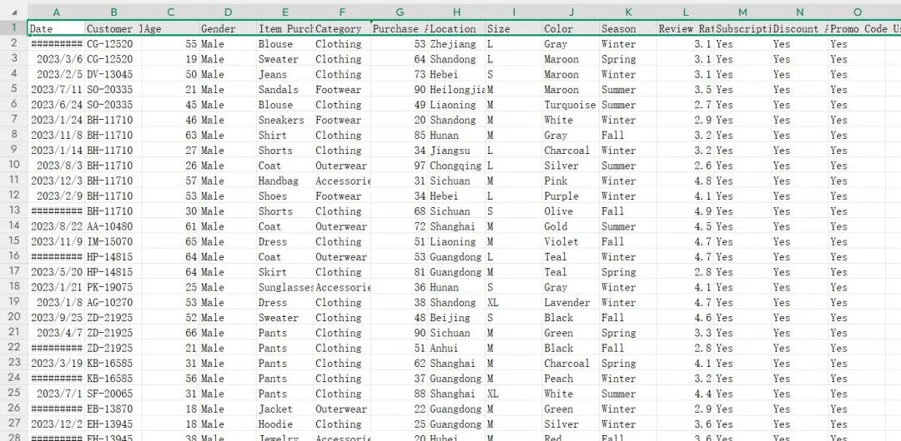

# Store Shopping Trend Analysis Dataset in CSV Format

In the era of rapid digital business development, a deep understanding of consumers' shopping behaviors and preferences is crucial for businesses to formulate precise marketing strategies and optimize product services.

## Background description

In the era of rapid digital business development, it is crucial for businesses to deeply understand consumer shopping behaviors and preferences in order to formulate precise marketing strategies, optimize product services, and enhance market competitiveness. To meet this demand, we have collected and organized this shopping trend dataset.

## Data Description

This dataset contains 3900 shopping transaction records, covering 15 key attributes. Each record details the transaction in detail, including the date of the transaction (Date), customer unique identifier (Customer ID), age of the customer (Age), gender (Gender), name of the purchased item (Item Purchased), category of the item (Category), amount spent on the purchase (Purchase Amount), location of the purchase (Location), size of the item (Size), color of the item (Color), season of the purchase (Season), review rating given by the customer (Review Rating), subscription status of the customer (Subscription Status) and whether a discount was applied or a promo code used (Discount Applied and Promo Code Used). These attributes describe consumer shopping behaviors and preferences from multiple perspectives, providing rich material for subsequent data analysis.

## Data source

Data sourced from a comprehensive e-commerce platform and its offline stores. The platform covers a wide range of product categories, including daily necessities such as clothing and footwear, with offline stores located in various regions to ensure the breadth and diversity of data sources. By integrating both online and offline transaction data, it can comprehensively reflect consumer behavior across different shopping channels.

## Payment

Here is a pay link on Stripe ( https://buy.stripe.com/3cs8yP7sY87d0vu9AB ). Please contact me lonlonago@foxmail.com after funding $89, and I will send you a complete data files , thank you!

